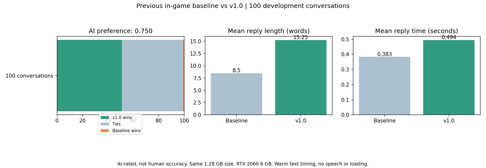

# TinyNPC v1.0: fast local NPC dialogue for games

I wanted NPCs I could actually talk to. Small enough to ship, quick enough to keep a conversation moving, and simple enough to drop into a game.

TinyNPC is a **1.28 GB local dialogue model** with a lightweight integration for character personality, memory, and the things an NPC can see around it. On my **RTX 2060 6 GB**, v1.0 averaged **0.494 seconds per text reply** in a 100-conversation development run, excluding loading and speech. No cloud API or paid inference service is required.

Define who an NPC is in JSON, send descriptions of what it can see, and add the player's message. The runtime combines those inputs into the model's context. One model can serve many different characters. **[Design your first NPC](docs/characters.md)** using the included character and POV files.

**[Download the model](https://github.com/Ataher-KoW/tinynpc/releases/tag/v1.0)** | **[Game integration](docs/integration.md)** | **[v1.0 results and limits](docs/v1.0.md)** | **[Model card](inference/MODEL_CARD.md)**

[Watch baseline vs v1.0, side by side](https://github.com/Ataher-KoW/tinynpc/releases/download/v1.0/tinynpc-baseline-v1.0-demo.mp4). Real outputs, edited pacing. The game and audio services were not my focus; I made a simple game to show the model.



I chose v1.0 after trying it in the game. In 100 development conversations, the AI judge preferred it **51 times**, tied **48**, and preferred the previous baseline once: a **0.750 preference score**. It completed all 100 conversations and gave more developed replies while keeping the same **1.28 GB** size. Mean reply time was **0.494 seconds** on my RTX 2060. [Full comparison and measurement limits](docs/v1.0.md). AI preference is not human-verified quality, and longer replies are not automatically better.

## What you get

- Short, in-character text replies from one shared local model.
- Editable NPC JSON definitions for background, character description, known facts, and speaking style.
- Personality controls such as humor, bravery, friendliness, and patience, from 0 to 100.
- Separate conversation memory for each NPC and player.
- Point-of-view context: visible entities, distance, direction, and an optional game-provided caption.
- A Python API, a local HTTP API, a terminal demo, and benchmark data you can inspect.

This release is text only. Bring your own game, speech system, and UI. The game stays in charge of visibility and actions. The model produces dialogue; it cannot move characters or change your world by itself.

## Try it

The automatic setup below is for **Windows x64 with an NVIDIA GPU**, using Python 3.10 or newer. This is the path tested on my PC. CPU and other platforms are covered in [integration](docs/integration.md).

```powershell
git clone https://github.com/Ataher-KoW/tinynpc.git
cd tinynpc
python -m inference.setup --runtime windows-cuda
python -m examples.chat
```

Setup downloads ten verified model parts, assembles one model file, verifies its checksum, and installs the pinned native runtime. The Python runtime code itself uses only the standard library. The **1.28 GB number is the model file**, not the full installation. The Windows CUDA runtime archives add about **646 MB of downloads** and need more space after extraction. Allow at least 6 GB of free disk space for installation.

If a download is interrupted, run setup again. It resumes a partial download and verifies the complete file. Already have a compatible native runtime? Use `python -m inference.setup`, then set its path in `inference/config.json`.

## Put it in your game

Start the local bridge:

```powershell
python -m core.http_api
```

Send JSON to `http://127.0.0.1:8765/chat`:

```json
{
  "player_id": "player-1",
  "npc": {
    "id": "marcus",
    "name": "Marcus",
    "role": "city guard",
    "description": "Marcus grew up in Northbridge, enjoys baking bread, and speaks with gentle humor.",
    "known_facts": ["The east gate closes at dusk."],
    "personality": {"humor": 87, "bravery": 79, "friendliness": 65}
  },
  "text": "What is that place on your left?",
  "pov": {
    "location": "East gate square",
    "entities": [
      {"id": "bakery", "kind": "building", "description": "small stone bakery", "distance": 12, "direction": "left"}
    ]
  }
}
```

Read `speech` from the response and show it in your dialogue UI. Send requests asynchronously so your game keeps rendering. Use one bridge for all NPCs, rather than loading a separate model for every character. See [the full guide](docs/integration.md) for Python, Unity, Unreal, Godot, memory, and point-of-view setup.

## Speed and dialogue quality

On my RTX 2060 6 GB, v1.0 averaged **0.494 s per reply** in the 100-conversation development comparison, versus 0.383 s for the previous baseline. An AI judge preferred v1.0 in 51 conversations, tied 48, and preferred the baseline once. Replies averaged 15.25 words versus 8.50. Longer replies are not automatically better.

In a separate 320-turn development stress test, all v1.0 replies completed under one second with zero generation failures. Complete-reply p95 was **0.670 s**. It passed **19/24 narrow corrected-name/current-view checks**, versus 24/24 for the baseline. These literal checks do not measure overall conversation quality.

See [the exact statistics and limitations](docs/v1.0.md) and [machine-readable results](benchmarks/v1.0/statistics.json). No claim of improvement on an independent held-out benchmark is made for these weights.

Earlier [IFEval results](docs/standard-benchmarks.md), [NPC quality examples](docs/quality.md), and [speed graphs](docs/benchmarks.md) are historical results for earlier model versions, not v1.0 measurements.

## What still needs work

I like where this is now, but I do not want to sell you a perfect-human claim. Odd questions can still get awkward answers. Mood and personality controls are guidance, not exact guarantees. A longer test still used an old name after the player corrected it when structured memory was absent. The regular memory-assisted name test passed.

The integration enables an 8K context window. That means capacity, not proven perfect recall over 8K tokens. The older historical comparison used 2K context. The new fine-tune was trained with a 4K limit; runtime capacity is 8K, without a demonstrated filled-window recall guarantee.

The RTX 2060 is the only GPU measured here. I have not measured other GPUs, CPU-only performance, many simultaneous players, or phone hardware. Test your target hardware with `python -m benchmarks.run`.

## What is in the release?

The download is **1,282,438,944 bytes**, or **1.282 GB / 1.194 GiB**. Only the student weights are published. No larger teacher weights, voice models, private conversations, training checkpoints, or development environment are included.

Benchmark transcripts and timing data are in [benchmarks/results](benchmarks/results). They are synthetic test conversations. Training data provenance and licenses are explained in the [model card](inference/MODEL_CARD.md); raw training corpora are not bundled.

## Development

```powershell
python -m pip install -r requirements-dev.txt
python -m pytest -q
python -m benchmarks.plot
```

The integration code is MIT licensed. The model derives from an Apache-2.0 base; its license and modification notice are included under `inference/`. See [third-party notices](NOTICE.md).

For the next local character-training experiment, see [the complete overnight guide](docs/character-overnight.md). It covers connected conversations, flexible replies, preference training, persistent character context, and blind human review.
