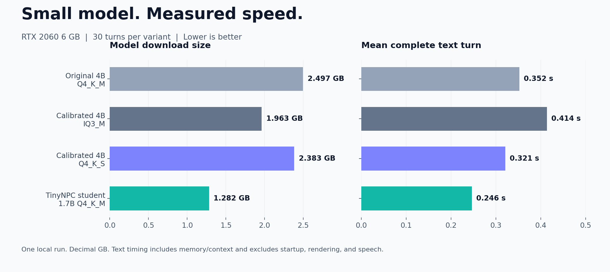
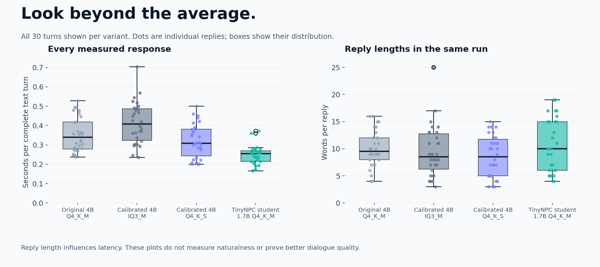

# What the comparison actually measured

I wanted to see whether a smaller model could keep the conversation moving without carrying the larger model's download size. These are the results from my own PC, with the raw turns included so you can judge more than the averages.

## Setup

- GPU: NVIDIA GeForce RTX 2060, 6 GB VRAM.
- System memory: 16 GB. OS: Windows.
- Runtime: llama.cpp b11060, commit 426090367, full GPU offload, four CPU threads, flash attention enabled.
- Shared settings: 2,048 context tokens, 180 maximum output tokens, seed 42, temperature 0.65.
- Workload: 30 turns per model across two character profiles and four scenarios: name correction, changing topic away from a task, unknown visual references, and casual conversation.
- One run per model. Native startup and warm-up precede measured turns. No confidence intervals are claimed.

The timer covers the complete text turn: context preparation, generation, and memory storage. Speech recognition, synthesis, game rendering, model download, and model startup are excluded. Generations are not normalized to the same response length, so the response-length graph is provided alongside timings.

## Results

The smaller student had 49% less file size and 30% lower mean text latency than the original larger model. The calibrated Q4_K_S version was also smaller and faster than the original. IQ3_M reduced size further but was slower here. That is why lower bit count should not be treated as an automatic speed improvement.

The simple flags count exact repetitions, echoes, missing names in the short correction test, and possible task fixation. They do not score humor, truthfulness, empathy, or overall conversation quality. Zero flags does not mean flawless dialogue.

## Extra probes and the known failure

The student also ran seven separate prompts at an 8,192-token configured context. These probes cover surreal input, unclear wording, unknown facts, clarification, mood, and a longer name-correction history. They do not fill all 8K tokens.

The long history changed the player's name from Zuri to Dev. The student still answered "Zuri, you left a copper flute at the mill." That is a failure, and it is flagged in [student-extra.json](../benchmarks/results/student-extra.json). The original model also missed that history-only correction. The main benchmark's structured-memory correction test passed.

The surreal reply was awkward, and the angry-state reply invented chores. Those weaknesses are visible in the full transcript even though they are not detected by the simple lexical flags. Do not read the charts as proof that the student is more human than the larger model.

## Inspect and reproduce

- [Original larger model turns](../benchmarks/results/00.json)
- [Calibrated IQ3_M turns](../benchmarks/results/01.json)
- [Calibrated Q4_K_S turns](../benchmarks/results/02.json)
- [Student turns](../benchmarks/results/03.json)
- [Additional student probes](../benchmarks/results/student-extra.json)
- [Environment metadata](../benchmarks/environment.json)

Run `python -m benchmarks.run` to test your installed model. Results go to `data/local-benchmark.json`. Set `context_tokens` to 2048 in `inference/config.json` for the main comparison settings. The release defaults to 8192 for additional conversation capacity. Close other GPU jobs and keep prompt, model, runtime, and settings unchanged when comparing runs.

Run `python -m benchmarks.plot` after installing development requirements to regenerate the published charts from the checked-in measurements. The chart script never generates synthetic timings.

We did not benchmark unrelated model families or other GPUs. There is no basis here to promise 0.2 to 0.5 seconds on different hardware. A newer GPU, an older GPU, CPU offload, a long prompt, or concurrent requests can all change the result.
