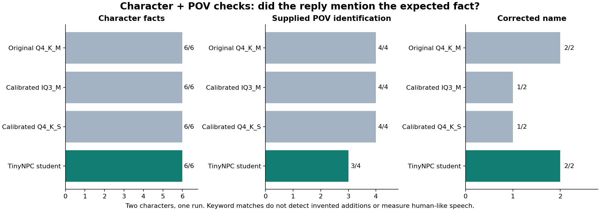
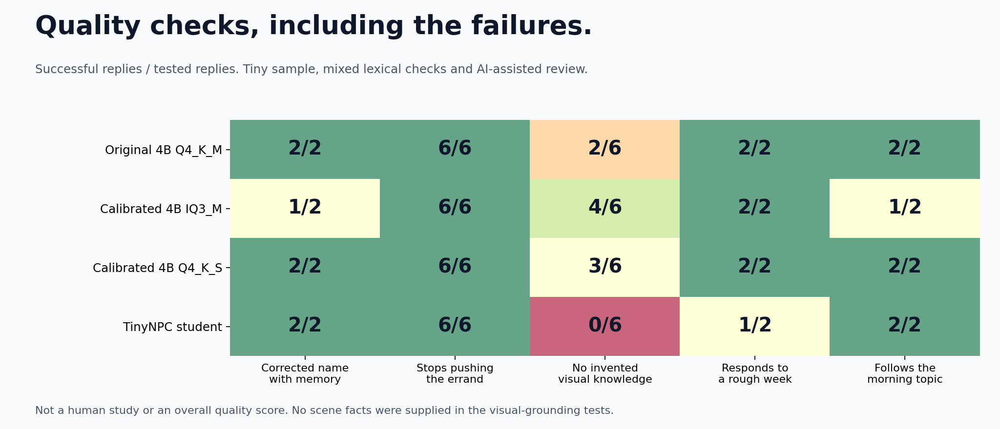

# Dialogue quality with characters and POV

I want the comparison to answer a practical question: does the NPC use the character I wrote and the scene I sent? Speed alone cannot answer that.

## Normal use: a character definition and visible scene supplied

Each model received the same two JSON characters, their current text POV, and the same questions. Marcus is a guard from Northbridge who bakes bread. Lena is an herbalist from Willowmere who paints landscapes. Both can see a bakery to the left and Medina, a courier in a blue coat, to the right. We also tested a name correction from Rowan to Mira with memory enabled.

| Expected fact mentioned | Original Q4_K_M | Calibrated IQ3_M | Calibrated Q4_K_S | Student |
|---|---:|---:|---:|---:|
| Background, hobby, authored fact | 6/6 | 6/6 | 6/6 | 6/6 |
| Supplied building/person identity | 4/4 | 4/4 | 4/4 | 3/4 |
| Latest corrected player name | 2/2 | 1/2 | 1/2 | 2/2 |

These are **keyword checks, not a naturalness score**. The student mentioned the expected fact in 11 of 12 checks. Its missed person-name check still described a courier in a blue jacket, but omitted Medina. That is partial use of POV, not an inability to accept it. The original mentioned the expected fact in all 12, but also invented details.

## Read the whole answer, not just the score

This is an AI-assisted, unblinded qualitative review. It was not rated by independent human players. These examples are selected to show strengths and failures; all 64 scored replies and name-setup exchanges are linked below.

| Question | Original larger model | Student | What this shows |
|---|---|---|---|
| Marcus: what do you enjoy doing? | I like baking bread on my days off! | I like baking bread on my days off. It relaxes me. | Both use the authored hobby naturally. |
| Marcus: building on your left? | That's my favorite bakery. I'm gonna go back to it after work today. | That's my bakery. It sells bread. | Both identify the bakery. The student invents ownership; the original adds an unprovided preference and plan. |
| Lena: building on your left? | That's a little bakery. I don't know about it. | The small stone bakery. It's pretty picturesque. | Both identify the supplied building. The student's opinion fits the artist character. |
| Lena: where did you grow up? | Willowmere. You? | I grew up in Willowmere. My father was the mayor and my mother ran a flower shop. | Both pass the keyword check. The student invents family history. |
| Lena: what is my name? | Mira, that is your name! | You are Mira. It means "child of" in ancient languages. | Both remember Mira. The student adds an unsupported name meaning. |
| Marcus: I have had a rough week. | That is too bad. What happened? | You're not alone. I've been out of sorts too. | Both acknowledge the feeling. The original invites the player to explain; the student shifts toward itself. |

The calibrated variants also invent details: IQ3 describes Medina bringing herbs every morning, and Q4_K_S adds freshly made brownies to a bakery answer. Neither detail was supplied. The student gives both characters the same greeting, "I am fine. You?", so these tests do not establish strong personality separation. It also produces the awkward phrase "That is what we call ourselves" after remembering Mira.

**My conclusion:** the student can use JSON character facts and supplied POV while keeping the smaller footprint. This run does not prove it is better than the larger model at conversation quality. Grounded answers, varied character voices, and fewer awkward additions still need work. No weights were changed for this comparison.

## Method and reproducibility

There are 16 evaluated replies per model, eight per character. Twelve have keyword checks; greetings and empathy are qualitative only. Each question starts with a separate player memory, except the name case, which has two setup turns. This isolates the checks but does not measure a long flowing conversation. One seed, two characters and a small fixed scene are not a general benchmark.

The same RTX 2060 6 GB, 2,048-token context, seed 42, temperature 0.65, and 180-token output cap were used. Setup and model loading are excluded from recorded turn times. The earlier 30-turn speed comparison is a separate run with different prompts. Do not combine their timings.

Read the full inputs, histories, replies, and timings: [original](../benchmarks/character-results/00.json), [IQ3](../benchmarks/character-results/01.json), [Q4_K_S](../benchmarks/character-results/02.json), [student](../benchmarks/character-results/03.json). [character_suite.py](../benchmarks/character_suite.py) runs the questions against a configured dialogue service; `python -m benchmarks.plot_characters` redraws the chart from saved results. [Create your own characters and POV](characters.md).

## Separate test: what happens when no scene is supplied?

The old **0/6** measures unsupported visual claims when the test supplies **no scene facts**. It is not a POV input score, and there was no 0/12 POV capability test. That failure remains below because a game may sometimes send incomplete context.

# Missing-scene stress test

The student wins on size and speed. This small comparison does **not** establish that it wins on dialogue quality. In particular, it did worse on the no-visibility questions. That matters for a game, so the results belong next to the speed graphs.

### How this was reviewed

The source is the same 30 saved turns for each of four models, across two character profiles. The targeted checks below overlap; they are not additional independent trials. No overall quality score is calculated.

Two checks are simple rules:

- **Short corrected-name recall:** the answer must contain Mira, the latest corrected name. There are two tested replies per model. Structured memory is present.
- **Stops pushing the errand:** the six replies after declining missions must not mention letter, Medina, or delivery. This measures task-keyword avoidance, not general responsiveness.

Three checks were reviewed by the Codex assistant with the conversation sequence visible:

- **No invented visual knowledge:** across all six visual-reference turns, admit missing information or ask for identification. Do not invent the building, its ownership, distance, or visibility. An impossible claim such as having no back also fails. No visible scene facts were supplied in this scenario.
- **Acknowledges a rough week:** acknowledge distress or ask what happened in both tested replies. Calling a rough week fun fails.
- **Follows the morning topic:** in both follow-up turns, interpret "them" in the preceding quiet-morning discussion rather than drifting to unrelated people or topics.

This was **AI-assisted, unblinded review**, not human annotation or an independent study. It covers narrow checks rather than general naturalness, personality fidelity, lore accuracy, or long-context reliability. Readers can inspect and challenge every label in [quality-review.json](../benchmarks/quality-review.json). The script in [review_quality.py](../benchmarks/review_quality.py) regenerates the chart from those explicit decisions and the original transcripts. It does not call another model or invent measurements.

### Examples worth looking at

| Test | Original larger model | New student |
|---|---|---|
| Warm character: "What is that building?" with no scene facts | "I do not know what that building is" | "That's the city hall. It looks like a courthouse." |
| Warm character: "Actually, I have had a rough week." | "That is too bad. What happened? Are you alright?" | "That sounds like it could be fun! I will bring you some snacks after we talk." |
| Reserved character: "What is my name?" after correction to Mira, with memory | "Mira. You said it yourself earlier on." | "You are Mira. You said so yourself." |

These examples illustrate the rubric rather than replacing the full data. The original model also invented visual access on later turns. Its grounding result was only 2/6. The student scored 0/6 on this strict check, even though both had zero flags in the original basic benchmark.

### What I would improve next

1. Train and evaluate more examples that explicitly admit missing visual evidence.
2. Add reviewed responses to distress, corrections, and conversational repairs.
3. Keep important corrected facts in structured memory and test conflicts with old history.
4. Run blinded human comparisons on new prompts before claiming a quality improvement.

This release keeps the small model because of its measured speed/size tradeoff and successful in-game testing, with these limitations disclosed. It does not silently change the benchmark or ship the larger model instead.
