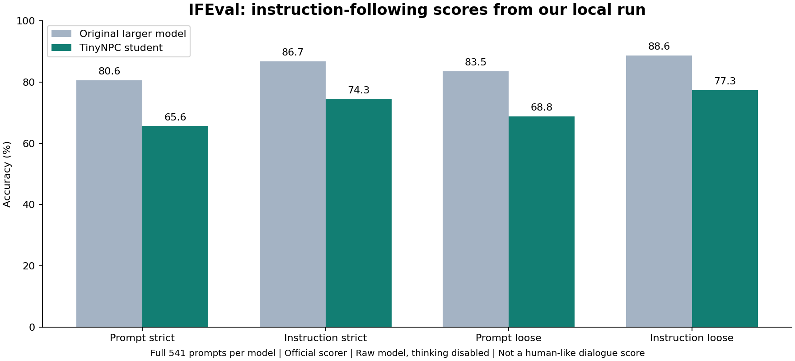

# Recognized benchmark scores

The small character/POV checks are integration tests. They are not MMLU, GPQA, or a recognized dialogue benchmark. I keep them separate from standard model evaluations.

## Measured IFEval results



| IFEval accuracy (%) | Original larger model | Student |
|---|---:|---:|
| Prompt strict | 80.59 | 65.62 |
| Instruction strict | 86.69 | 74.34 |
| Prompt loose | 83.55 | 68.76 |
| Instruction loose | 88.61 | 77.34 |

The original larger model wins on all four metrics in this run. The student is 14.97 percentage points lower on prompt-strict accuracy and 12.35 points lower on instruction-strict accuracy. Its smaller size and faster short dialogue responses do not imply better instruction following.

Both runs include all 541 prompts. Output-cap truncations: original 75, student 94. Native-server output parse failures: original 3, student 0. Parse failures are recorded as empty failed answers. No failed or truncated items are removed from the denominator. The original run resumed after a reproducible parser failure; completed answers were retained. [Raw answers, official per-item labels, and provenance](../benchmarks/ifeval-results).

## IFEval

[IFEval from Google Research](https://github.com/google-research/google-research/tree/master/instruction_following_eval) tests instruction following with verifiable constraints. We use its full 541-prompt dataset and official scoring functions. Results use the normal four metrics, on a 0 to 100 scale:

- Prompt strict: every instruction in a prompt must pass.
- Instruction strict: each individual instruction counts separately.
- Prompt loose: all instructions pass after the scorer's allowed formatting variations.
- Instruction loose: individual instructions pass under those same variations.

IFEval measures instruction compliance, not truthfulness, roleplay, or whether a conversation feels human. It can include long responses and unusual formatting that differ from normal NPC dialogue. We test the raw model without the game persona prompt, memory, JSON grammar, or repetition repair. The benchmark does not change the in-game configuration.

Both models were run locally on an RTX 2060 6 GB with greedy decoding, seed 42, thinking disabled, an 8,192-token context, and a 2,048-token output cap. Each uses its native chat template, with the benchmark prompt as the user message and no system message. Any replies cut off at that cap are retained and reported, not removed. Scores from other sites may use different templates, output limits, or inference settings, so this controlled local comparison is more informative than copying leaderboard numbers.

## Reproduce

Redraw the published chart with `python -m benchmarks.plot_ifeval` after installing `requirements-dev.txt`.

From the repository root, after model/runtime setup:

```powershell
python -m pip install -r benchmarks/requirements-ifeval.txt
python -m benchmarks.prepare_ifeval
python -m inference.evaluate_ifeval --config inference/config.json --label student --output data/ifeval/results/student
```

This runs evaluation, not training. It saves every response and resumes completed prompts after an interruption. Use a fresh output directory after changing a model or settings. A second model can be evaluated with a separate inference config and output directory. Only the student weights are published: reproducing the original-model row requires the matching original weights identified by checksum. Its saved replies and scoring decisions are still available for audit. Upstream code and data are downloaded at the revision and SHA-256 hashes in `benchmarks/ifeval-source.json`; they stay out of the release package. They retain the upstream Apache-2.0 license. Evaluation dependencies are optional and are not needed to use TinyNPC.

## Character quality is a separate question

[CharacterBench](https://github.com/thu-coai/CharacterBench) evaluates character customization and uses a dedicated CharacterJudge. [PersonaGym](https://github.com/vsamuel2003/PersonaGym) evaluates persona behavior through its own judging framework. We have not completed either official protocol, so no TinyNPC scores are claimed for them. I will not relabel custom 1-to-5 opinions as their official scores.

MMLU, GPQA, AIME and SWE-bench address other abilities. No measured scores for those benchmarks are available in this release. A model's published base-model score is not automatically a score for these fine-tuned, quantized weights.
